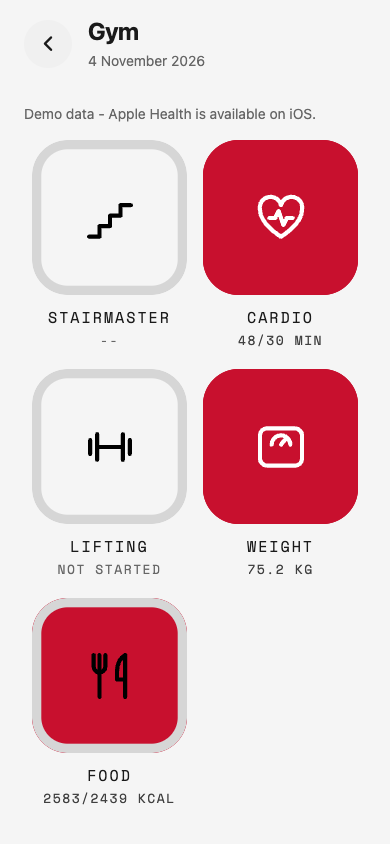
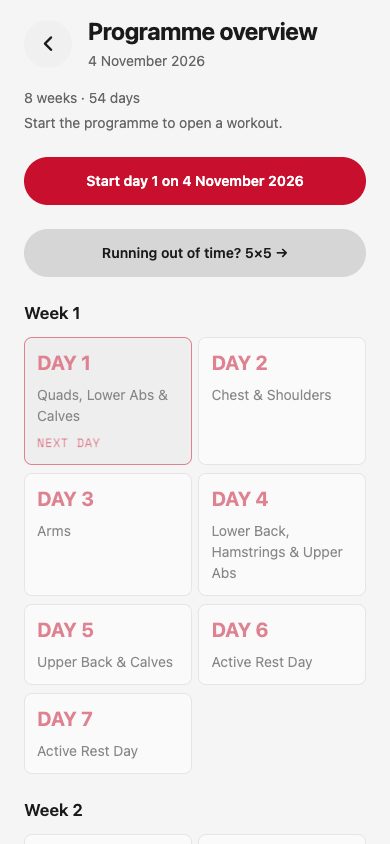
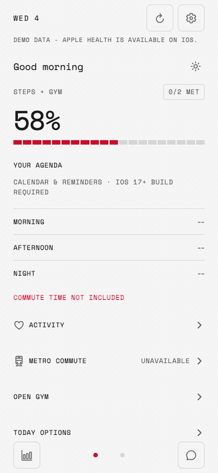

# gym

An iOS-first daily dashboard for Apple Health, workouts, and the rest of your routine.


[](LICENSE.md)

<p align="center">
  
  
  
</p>
<p align="center"><sub>Web preview with deterministic demo data. On iOS, dashboard readings come from Apple Health.</sub></p>


[Open the screen tour as MP4 (QuickTime-compatible)](docs/screenshots/workout-flow.mp4)

## What it is

HealthKit readings are read on-device; workouts and other approved logs stay on-device too. There is no app account or backend. Web and Android use deterministic demo data.

- Daily activity, recovery, and health dashboard
- Lifting programme, on-device workout log, and optional Apple Watch remote
- Prayer times, speaking practice, and a Today planner

## Run locally

Requires macOS, [Bun 1.3.5](https://bun.sh/), Node.js 20.19.4+, Xcode 26, and CocoaPods for iOS.

```sh
bun install
bun run ios   # build and launch on an iOS simulator
bun run web   # browser preview; uses demo data
```

`bun run start` starts Expo for an already-installed development client. The first native build can take several minutes; a physical device also needs Apple signing. No backend or environment file is required.

Run the local checks:

```sh
bun run lint
bun run typecheck
bun run test:unit -- --runInBand --no-watchman
```

## Build for TestFlight with EAS

You need an Expo account, Apple Developer Program membership, and an App Store Connect app record. EAS cloud builds may use paid plan resources.

For your own app or a fork, set your bundle IDs and widget App Group in `app.json`, remove or replace this repo's `extra.eas.projectId` and `updates.url`, and set `submit.production.ios.ascAppId` in `eas.json` to your App Store Connect app ID. Replace the OAuth client IDs if you use Spotify or Google sign-in.

```sh
bunx eas-cli login
bunx eas-cli init
bunx eas-cli update:configure
bunx eas-cli build --platform ios --profile production --auto-submit
```

On the first build, follow EAS prompts to configure Apple signing and App Store Connect credentials. After Apple processes the upload, add testers in App Store Connect → TestFlight. A successful build or upload does not mean the build is already available to testers.

In this repository, merging to `main` runs a fingerprint-gated release: JavaScript/assets can publish an OTA update, while native changes require a new build and a version bump in both `app.json` and `package.json`. CI needs an `EXPO_TOKEN` secret. The automated submission guard is limited to `ragmha/gym`; forks should use the manual EAS command above or update that guard for their own repository.

## Project

```text
src/app/        Expo Router screens
src/components/ Shared UI
src/lib/        HealthKit, workout, and feature logic
src/stores/     Approved on-device logs and preferences
modules/        iOS and watchOS native modules
```

More detail: [Product](PRODUCT.md) · [Design](DESIGN.md) · [Developer evaluations](evals/README.md)

<details>
<summary>Native checks that do not need a simulator</summary>

```sh
swiftc modules/gym-watch/watch/WorkoutState.swift modules/gym-watch/watch/RepDetector.swift modules/gym-watch/Tests/main.swift -o /tmp/gym-watch-check && /tmp/gym-watch-check
swiftc modules/day-planner/ios/PlannerValues.swift modules/day-planner/Tests/main.swift -o /tmp/gym-day-planner-check && /tmp/gym-day-planner-check
```

</details>

## License

[PolyForm Noncommercial 1.0.0](LICENSE.md).
